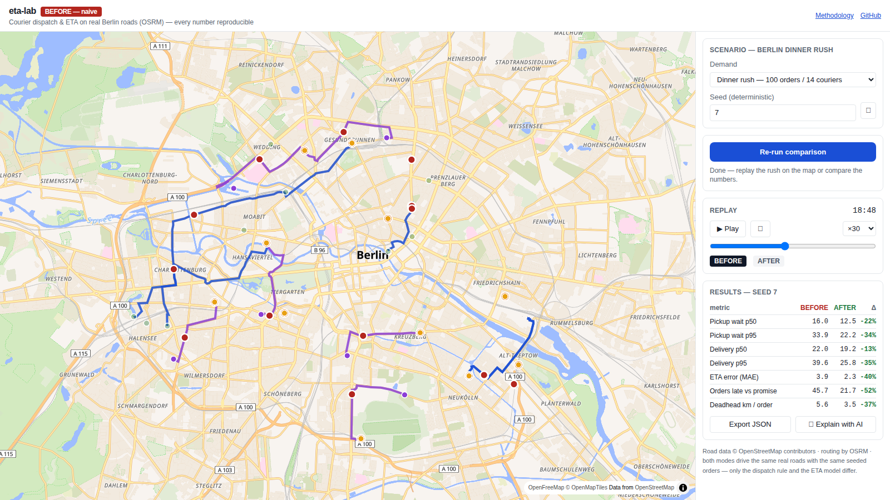
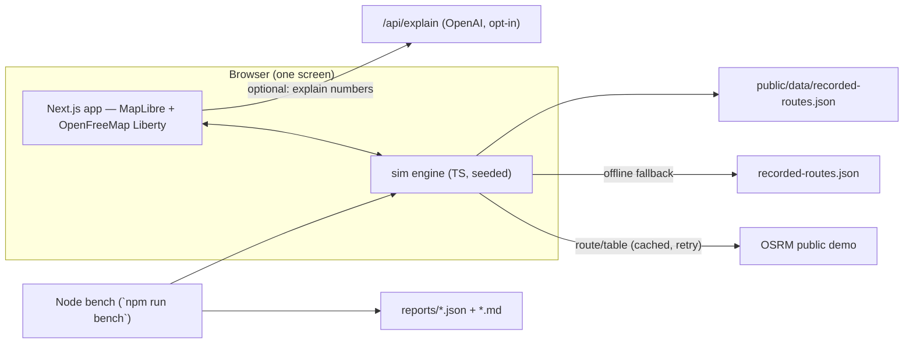

# eta-lab

**Why are food deliveries late?** — a one-screen, evidence-first lab that replays a Berlin
dinner rush on a real road network and shows what changes when you replace naive courier
dispatch and naive ETAs with road-aware ones. Every BEFORE/AFTER number is deterministic
and reproducible with one command.

[](#) [](#)



## Try it (60 seconds)

1. Pick a demand preset and a seed (any seed — results are deterministic).
2. Hit **Run BEFORE vs AFTER** — the same 100 seeded orders are dispatched twice on the same
   real roads (OSRM / OpenStreetMap).
3. Replay the rush on the map (play, scrub, speed), flip **BEFORE / AFTER**, and read the
   delta table. **Export JSON** downloads the run.

Live: **https://eta-lab.ricothen.com** · methodology: [`/methodology`](https://eta-lab.ricothen.com/methodology)

## Measured results (3 deterministic seeds, recorded snapshot — see `reports/`)

| seed | orders | pickup p50 | delivery p50 | ETA MAE | late vs promise | deadhead km/order |
|---|---|---|---|---|---|---|
| 7 | 46 | 16.0 → **12.5 min (−22%)** | 22.0 → 19.2 (−13%) | 3.9 → **2.3 min (−41%)** | 46% → **22%** | 5.55 → **3.48 (−37%)** |
| 11 | 50 | 17.0 → **14.9 min (−12%)** | 22.3 → 20.7 (−7%) | 5.0 → **3.1 min (−38%)** | 48% → **28%** | 6.31 → **4.51 (−29%)** |
| 42 | 57 | 23.4 → **18.7 min (−20%)** | 28.9 → 23.0 (−20%) | 7.0 → **2.5 min (−64%)** | 63% → **18%** | 6.34 → **4.21 (−34%)** |

All deltas green, every seed, every metric. Full tables: [`reports/`](reports).

## What differs between BEFORE and AFTER

Both runs drive the **same real roads** with the **same seeded orders**, the same couriers,
the same kitchen prep draws and the same per-leg traffic noise. Only the decision logic differs:

| | BEFORE (naive) | AFTER (smart) |
|---|---|---|
| Courier choice | nearest by *straight line*, idle-only, FIFO wait | nearest by *road travel time* (OSRM table), includes planned chaining of busy couriers |
| Customer promise | straight lines at 25 km/h + flat 10 min prep | road-time ETA where kitchen prep overlaps the pickup ride + 2 min buffer |

## Why the numbers are trustworthy

- **Deterministic engine** — seeded PRNG (mulberry32) generates arrivals, customers, prep
  times and traffic noise; the same seed always produces the same scenario and decisions.
- **Real roads, frozen evidence** — route durations come from OSRM on OpenStreetMap; the
  exact values behind the published tables are frozen in
  `public/data/recorded-routes.json`, so `npm run bench -- --recorded` reproduces them
  offline, byte-for-byte.
- **Honest ETA modelling** — the smart ETA accounts for the operational reality that cooking
  overlaps the pickup ride; both modes share identical noise draws, so the gap you see comes
  from the decision logic, not from luck.
- **Cross-checked** — the browser app and the Node benchmark run the same engine modules;
  the E2E test asserts the UI produces the exact numbers from `reports/`.

## Reproduce

```bash
npm install
npm run bench -- --recorded   # offline, reproduces reports/ tables
npm run selftest              # determinism + sanity assertions
npm run e2e                   # headless Chrome drives the deployed/local app
npm run dev                   # the app itself
```

(`npm run bench` without `--recorded` re-routes live against the public OSRM demo server and
refreshes the recorded snapshot.)

## Architecture



## Scope honesty

- Simulation, not production ops: no weather, no rider shifts, no batching (batching is a
  separate, larger lever deliberately out of scope).
- Venue names are synthetic; coordinates sit on real streets. No personal data.
- The public OSRM demo server is fair-use; the app degrades gracefully to the recorded
  snapshot (banner) if it is unreachable.

---

Part of a portfolio of delivery-ops projects — companion to
[lastmile-lab](https://github.com/ricothenfx/lastmile-lab) (multi-strategy dispatch platform).
